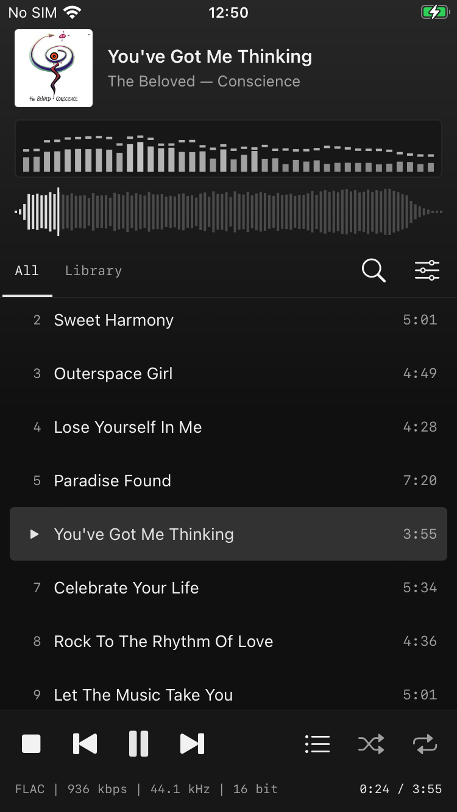

<p align="center"></p>

<h1 align="center">Flaco</h1>

<p align="center">A FLAC player for the iPhone 6s, in the spirit of foobar2000 with a modern skin.<br><i>Flaco</i> is Spanish for skinny.</p>

<p align="center"><code>iOS 15</code> <code>A9</code> <code>UIKit</code> <code>AVAudioEngine · vDSP</code> <code>Navidrome · Subsonic</code></p>

<p align="center"></p>

## Playback

| | |
|---|---|
| **Formats** | FLAC at 16 and 24 bit · ALAC · WAV · AIFF · MP3 · AAC |
| **Gapless** | Files of the same format play through one converter, so the joins are bit-identical: a test album measured −180 dB at the joins, against clicks at −28 dB with a converter per file. |
| **Sample rate** | The output switches between the 44.1 and 48 kHz families to match the file, so a CD rip isn't resampled where the output allows. The 6s speaker only takes 48 kHz, so there it resamples. |
| **ReplayGain** | Track or album, applied to the samples, held under full scale by the peak tags |
| **Out of sight** | Lock screen and Control Center · pauses when headphones come out · resumes after a call · waveform and spectrum work stops in the background, inside iOS's CPU limit |

## Look

| | |
|---|---|
| **Colours** | Everything takes its colours from the playing cover: the ground from its dominant hue, the accent from its most vivid colour. They fade over 0.6 s between songs. |
| **Spectrum** | 40 bands from 40 Hz to 16 kHz, from an FFT of the samples on their way to the output. Each frame is stamped with its sample time, so the bars move with what you hear, not with what's been decoded. |
| **Seekbar** | The song's loudness outline, decoded once and kept. A new song fills in bar by bar as it decodes. |
| **Status bar** | `FLAC \| 936 kbps \| 44.1 kHz \| 16 bit`, in mono, as in foobar |

## Library

Albums play as one list, each cover beside its tracks. A Library tab groups by album, artist or folder; search, a queue to drag into order, and Play next or Add to queue on any song.

Music comes in through Finder, the Files app, *Open in*, or a server.

## Server

Flaco doesn't stream. Point it at [Navidrome](https://www.navidrome.org), or any server with the Subsonic API, and it keeps a copy of the music on the phone.

| | |
|---|---|
| **What** | Everything, or the artists, albums and songs you tick. A ticked artist brings their new albums when they reach the server. |
| **Files** | The originals, not transcoded, in the server's own folders |
| **Mirror** | What leaves the server leaves the phone. Music you added by hand is never touched, and nothing is removed while the server is empty or still scanning. |
| **Downloads** | Carry on with Flaco closed. Each song shows its megabytes as they arrive, with the speed. 4.47 GB took 231 s on the 6s over Wi-Fi. |
| **Sign-in** | By token, so the password never travels. It stays in the Keychain. |

A server can be this small:

```yaml
services:
  navidrome:
    image: deluan/navidrome:0.64.2
    ports: ["4533:4533"]
    volumes:
      - ./data:/data
      - ./music:/music:ro
```

## Build

Needs Xcode and [XcodeGen](https://github.com/yonaskolb/XcodeGen).

```sh
brew install xcodegen
xcodegen
open Flaco.xcodeproj
```

To sign for your own phone, make `Config/Local.xcconfig` with your team and a bundle identifier of your own:

```
DEVELOPMENT_TEAM = ABCDE12345
FLACO_BUNDLE_ID = com.yourname.flaco
```

With a free Apple account the app runs for seven days, then needs installing again. Build Release for the phone: the debug build is unoptimized and much slower on the A9.

## License

MIT
