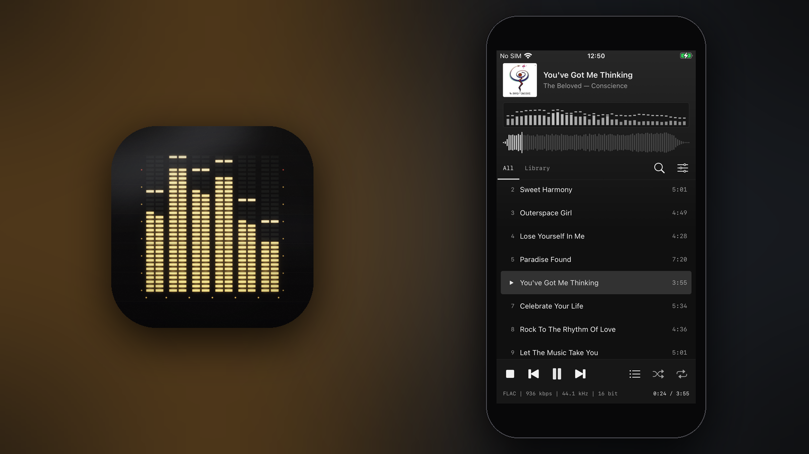
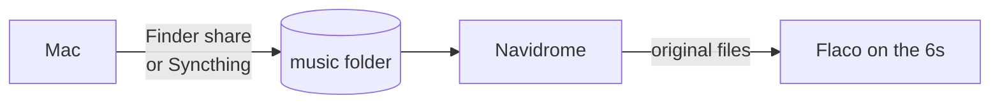

<p align="center"></p>

<h1 align="center">Flaco</h1>

<p align="center">A FLAC player for the iPhone 6s, in the spirit of foobar2000 with a modern skin.</p>

<p align="center"><code>iOS 15</code> <code>A9</code> <code>UIKit</code> <code>AVAudioEngine · vDSP</code> <code>Navidrome · Subsonic</code> <code>no streaming</code></p>



## Playback

| | |
|---|---|
| **Formats** | FLAC at 16 and 24 bit · ALAC · WAV · AIFF · MP3 · AAC |
| **Gapless** | Files of the same format play through one converter, so the joins are bit-identical: −180 dB at the joins of a test album, where a converter per file clicked at −28 dB. |
| **Sample rate** | The output follows the file between the 44.1 and 48 kHz families, so a CD rip isn't resampled where the output allows. The 6s speaker only takes 48 kHz. |
| **ReplayGain** | Track or album, applied to the samples, kept under full scale by the peak tags |
| **Out of sight** | Lock screen and Control Center · pauses when headphones come out · resumes after a call · waveform and spectrum work stop in the background, inside iOS's CPU limit |

## Look

| | |
|---|---|
| **Colours** | Everything takes its colours from the playing cover: the ground from its dominant hue, the accent from its most vivid colour. They fade over 0.6 s between songs. |
| **Spectrum** | 40 bands from 40 Hz to 16 kHz, each frame stamped with the sample time it plays at, so the bars move with what you hear rather than with what's been decoded |
| **Seekbar** | The song's loudness outline, decoded once and kept. A new song fills in bar by bar. |
| **Status bar** | `FLAC \| 936 kbps \| 44.1 kHz \| 16 bit`, in mono, as in foobar |

Albums play as one list, each cover beside its tracks. The Library tab groups by album, artist or folder, with search, a queue to drag into order, and Play next or Add to queue on any song.

## Server

Flaco doesn't stream. It keeps a copy of a [Navidrome](https://www.navidrome.org) library, or any Subsonic server's, on the phone.



| | |
|---|---|
| **What** | Everything, or the artists, albums and songs you tick. A ticked artist brings their new albums as they reach the server. |
| **Files** | The originals, not transcoded, in the server's own folders |
| **Mirror** | What leaves the server leaves the phone. Music added by hand is never touched, and nothing is removed while the server is empty or still scanning. |
| **Downloads** | Carry on with Flaco closed, each song counting up its megabytes. 4.47 GB took 231 s on the 6s over Wi-Fi. |
| **Sign-in** | By token, so the password never travels. It's kept in the Keychain. |

The smallest server that works:

```yaml
services:
  navidrome:
    image: deluan/navidrome:0.64.2
    ports: ["4533:4533"]
    volumes:
      - ./data:/data
      - ./music:/music:ro
```

## Icon

A vacuum fluorescent display, drawn by [`Tools/icon.py`](Tools/icon.py) as if photographed: six bands of dashed phosphor with the peaks held above, ghost segments, the control mesh, filament wires, a faint reflection of the glow in the front glass, room light and a little grain.

## Build

Needs Xcode and [XcodeGen](https://github.com/yonaskolb/XcodeGen).

```sh
brew install xcodegen
xcodegen
open Flaco.xcodeproj
```

To sign for your own phone, make `Config/Local.xcconfig` with your team and a bundle identifier of your own:

```
DEVELOPMENT_TEAM = ABCDE12345
FLACO_BUNDLE_ID = com.yourname.flaco
```

Build Release for the phone; the debug build is unoptimized and much slower on the A9. With a free Apple account the app runs for seven days before it needs installing again.

## License

MIT
